# ZUULS

*English · [Deutsch](README_de.md)*

A spooky arcade-style platformer – entirely contained in a single HTML file (`zuuls.html`), with no dependencies.
Its special feature: the look and sound can be switched between five retro systems **at any time while playing**.

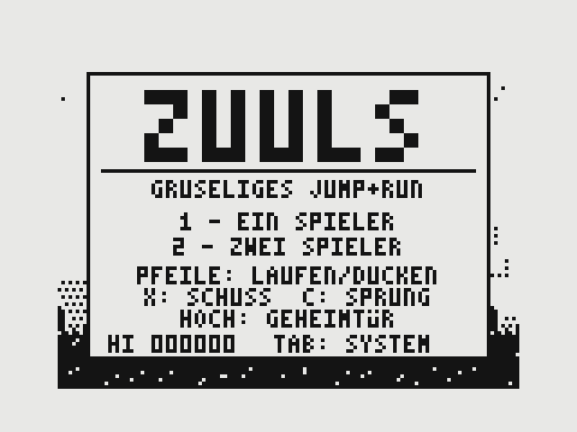

## Getting started

Play it right away in the browser: **https://whaslbeck.github.io/Zuuls/zuuls.html**

Or download `zuuls.html` and open it locally. That is all.

The in-game text is in German.

## Controls

| Key | Function |
|---|---|
| Left/right arrow | walk |
| Down arrow | duck |
| Up arrow | enter a secret door |
| `X` | shoot |
| `C` or space | jump |
| `1` / `2` | start a game with one / two players (taking turns) |
| `P` | pause |
| `M` | sound on/off |
| `Esc` | back to the title screen |
| `Tab` or `S` | next system |
| `5` `6` `7` `8` `9` | pick a system directly: ZX81, Spectrum, Atari VCS, C64, Amiga |

## The game

- **Four levels, each with a boss:** graveyard (Grave Warden), swamp (Swamp Spider), crypt (Bone Worm), castle (Necromancer).
- **Enemies:** zombies and skeletons rising from graves, bats, hoppers, spitting plants, ghosts, knights, gargoyles.
- **Obstacles:** pits, spikes, water and lava, rafts, stalactites, flame jets.
- **Pickups:** five weapons (spear, knife, hammer, sickle, fire pot), armour, coins, gems, extra lives.
- **Helpers:** every level has a helper locked in a cage – owl, will-o'-the-wisp or kobold. Shoot the cage to free it.
- **Secrets:** barely visible secret doors leading to bonus rooms, and crumbling walls with caves behind them.
- **Combo bonus:** collecting the letters Z-U-U-L-S grants an extra life, armour, 5,000 points and brief invincibility.
- **Arcade rules:** 3 lives, an extra life every 20,000 points, a time limit with time bonus, checkpoints, high score.

## The five systems

Game logic, levels and controls are identical everywhere – only picture and sound change.
All images in a row show **the same moment of play**; only the system was switched.

### Sinclair ZX81

Black and white, 1 bit. Shades of grey exist only as dither patterns; the crypt and the secret rooms are shown inverted.

| Graveyard | Crypt | Final boss |
|---|---|---|
| 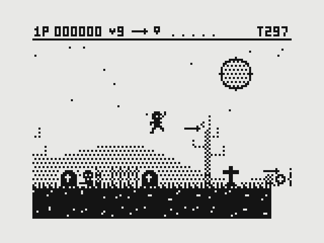 | 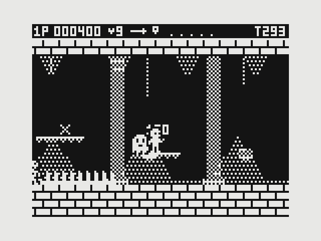 | 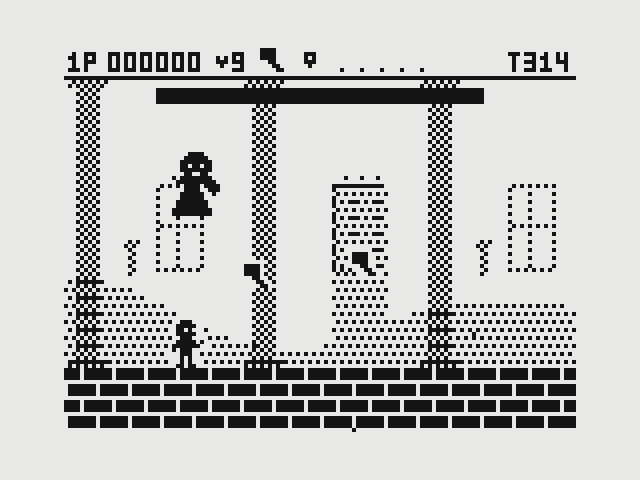 |

### ZX Spectrum

256×192 pixels, 15 colours on a black background. Real **colour clash**: each 8×8 cell has only one ink colour, so characters recolour the background and the ground around them. Scrolling happens in 8-pixel steps.

| Graveyard | Crypt | Final boss |
|---|---|---|
| 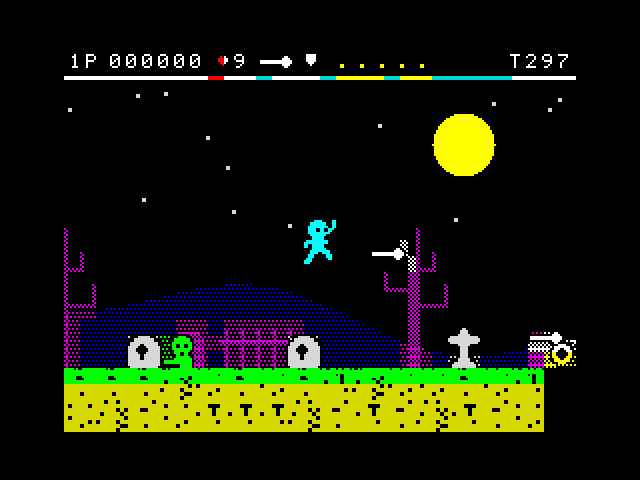 | 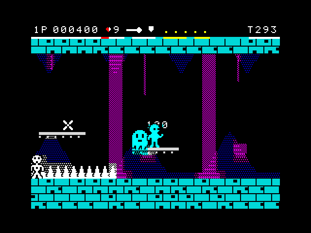 | 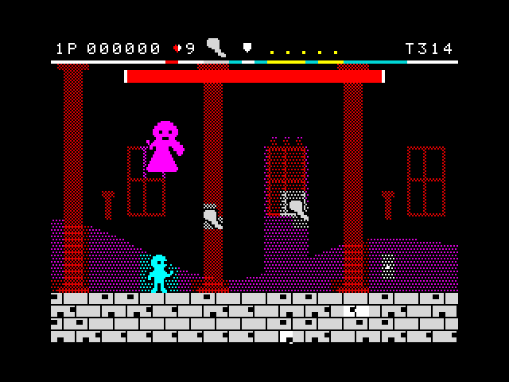 |

### Atari 2600 / VCS

Playfield blocks 4 pixels wide, colour bands per scanline, characters with one colour per line and no outline. With more than three characters at the same height they flicker in turn. Coarse scrolling, black bar at the left edge.

| Graveyard | Crypt | Final boss |
|---|---|---|
| 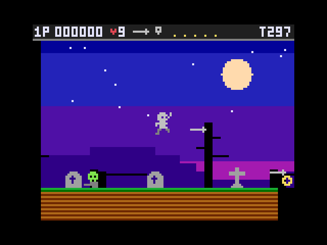 | 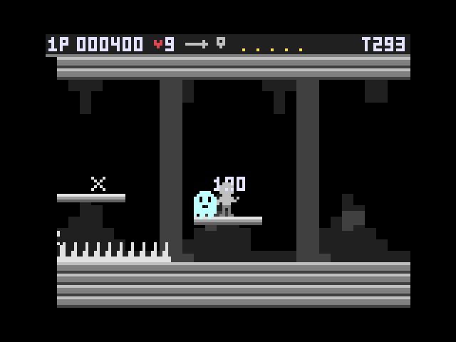 | 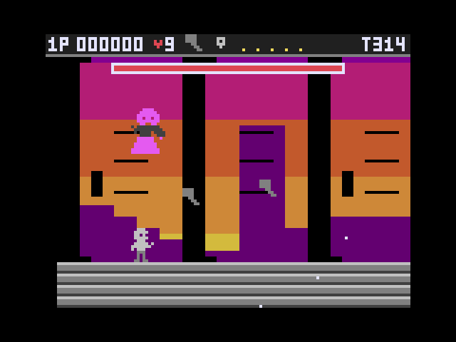 |

### Commodore 64

Wide multicolour pixels, the 16 C64 colours with plenty of brown, a raster-bar sky, sprites with black outlines. From the ninth sprite at the same height onwards, the surplus ones flicker.

| Graveyard | Crypt | Final boss |
|---|---|---|
| 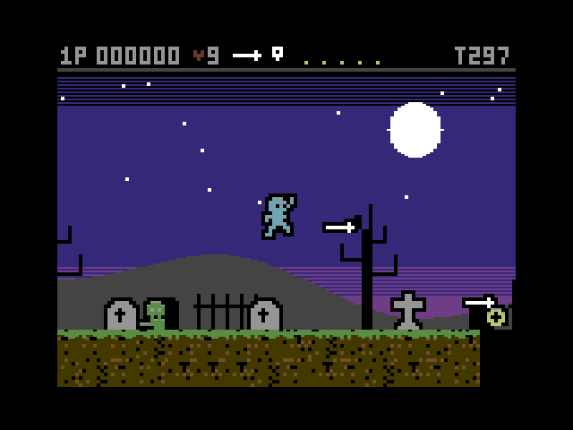 | 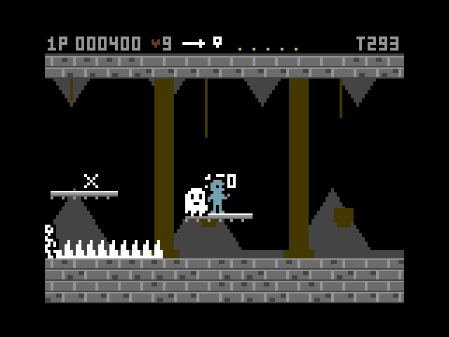 | 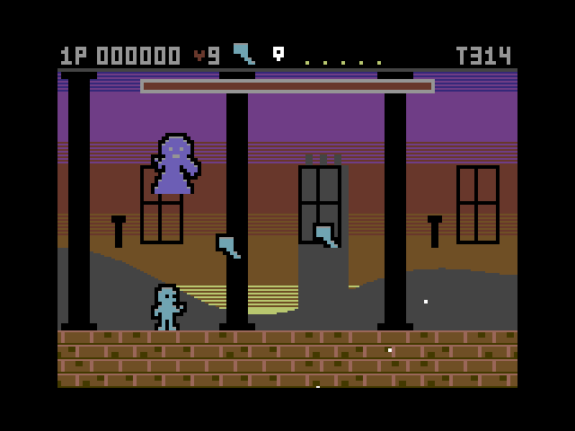 |

### Commodore Amiga

4096 colours, a copper gradient sky, an additional third parallax layer, shaded characters and tiles, smooth scrolling.

| Graveyard | Crypt | Final boss |
|---|---|---|
| 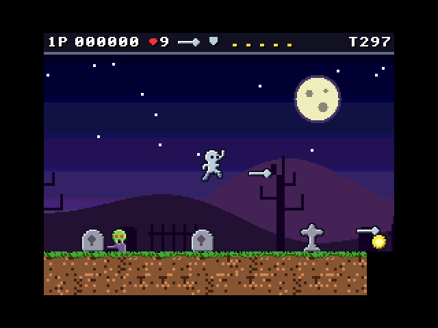 | 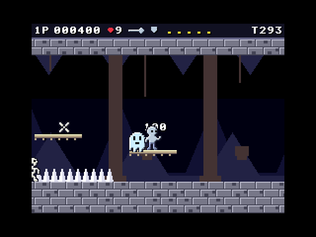 | 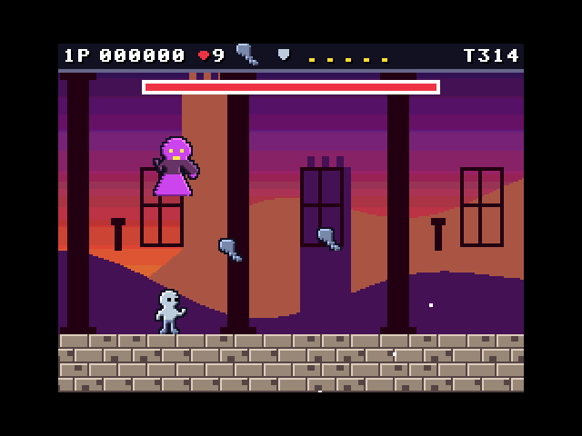 |

### Side by side

| | Swamp | Castle | Secret room |
|---|---|---|---|
| ZX81 | 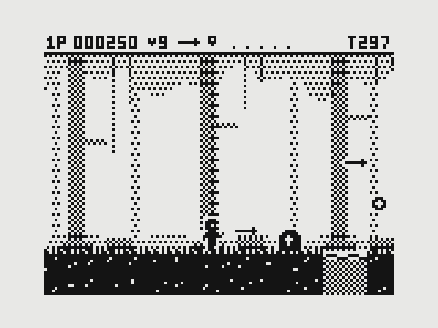 | 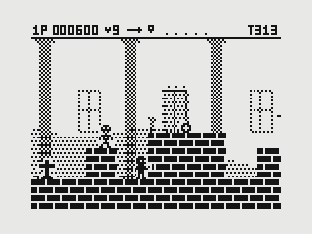 | 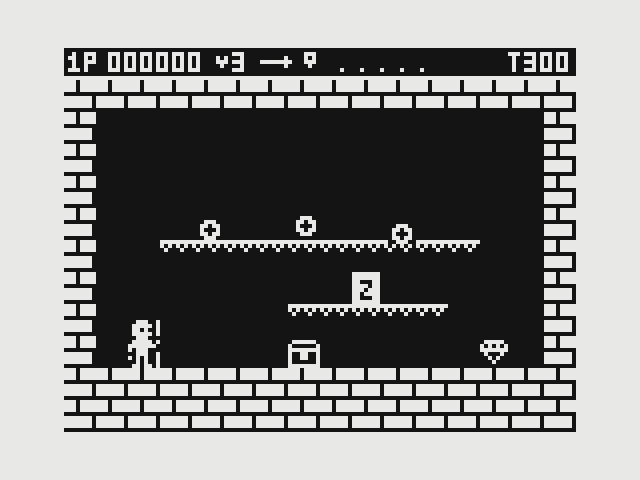 |
| Spectrum | 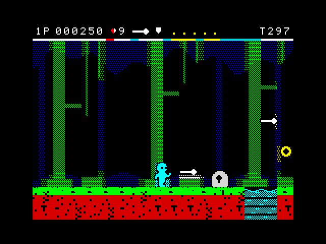 | 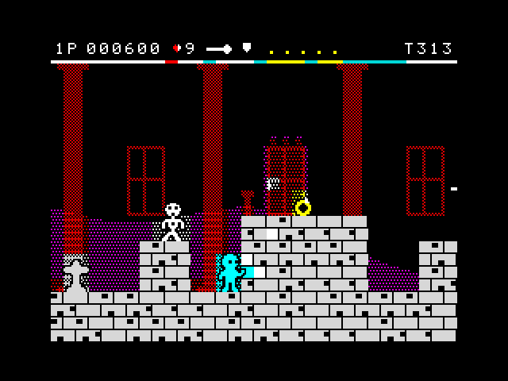 | 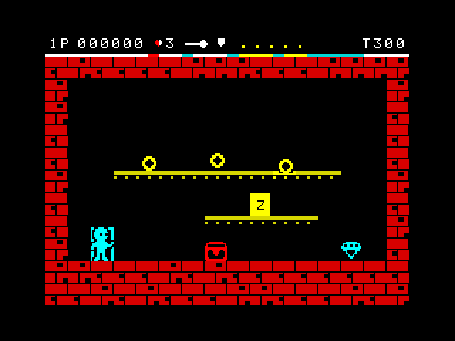 |
| Atari VCS | 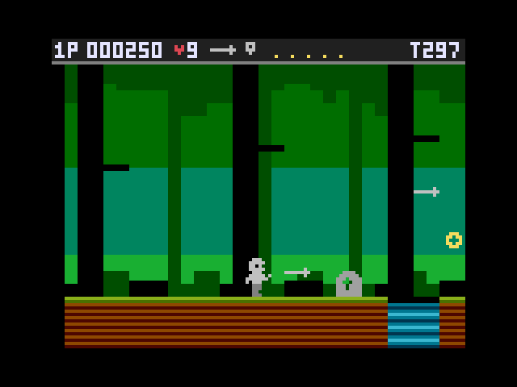 | 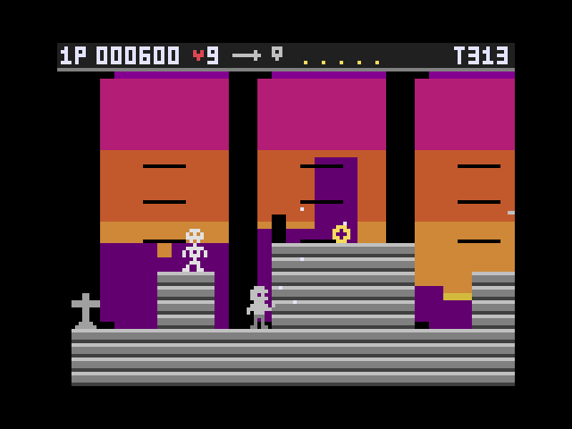 | 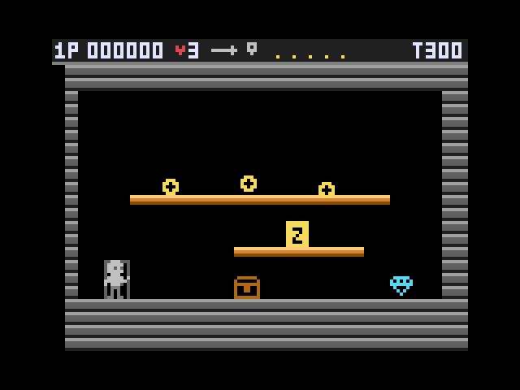 |
| C64 | 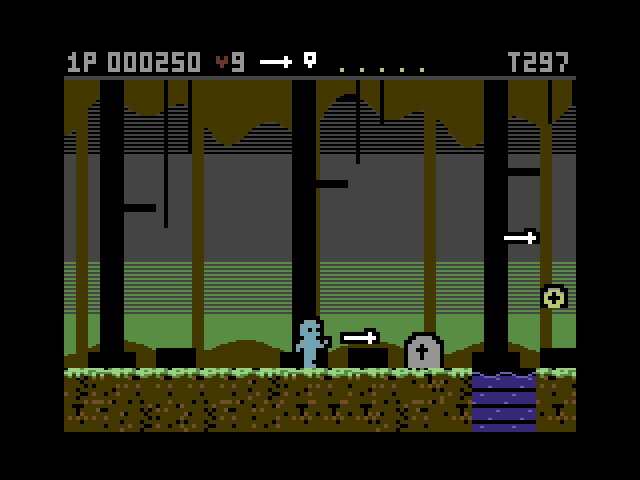 | 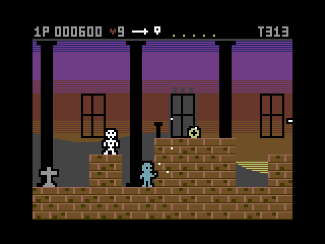 | 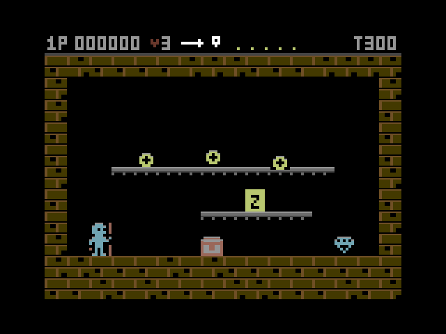 |
| Amiga | 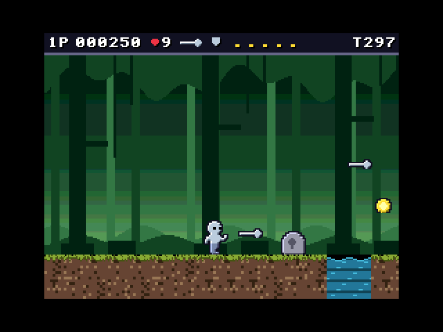 | 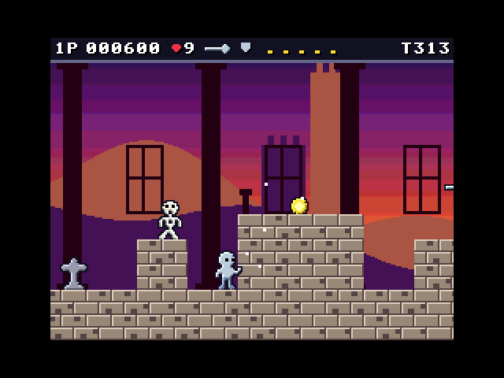 | 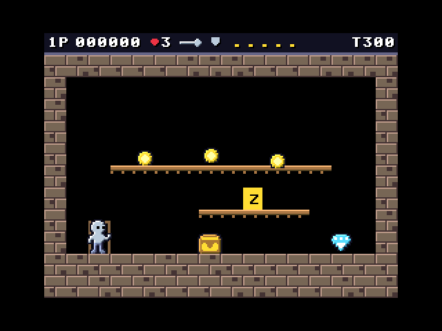 |

### Sound

| System | Sound profile |
|---|---|
| ZX81 | simple beeps (the original machine was silent) |
| ZX Spectrum | square wave with stepped pitches |
| Atari VCS | square wave on the out-of-tune pitch steps of the TIA chip |
| C64 | sawtooth with filter and arpeggio |
| Amiga | soft triangle wave, alternating left and right |

## Notes

- **Flicker:** in Atari and C64 mode, individual characters deliberately flicker at half the frame rate, as on the original hardware. Anyone sensitive to this should avoid those two modes.
- **Graphics:** all characters are derived from the ZX81 originals and are upscaled and coloured automatically for each system.
- **Hardware limits** are recreated in style, not emulated exactly.
- **Music:** there is none, only sound effects and short jingles.

## Files

| File | Contents |
|---|---|
| `zuuls.html` | the game with all five systems |
| `zuuls_zx81_v1.html` | the original ZX81-only version |
| `screenshots/` | the images for this README |
| `README_de.md` | this README in German |
| `LICENSE` | the licence text |

## Licence

ZUULS is released under the [MIT License](LICENSE).
