# ZUULS

*Deutsch · [English](README.md)*

Ein gruseliges Jump'n'Run im Arcade-Stil – komplett in einer einzigen HTML-Datei (`zuuls.html`), ohne Abhängigkeiten.
Die Besonderheit: Die Optik und der Klang lassen sich **jederzeit im laufenden Spiel** zwischen fünf Retro-Systemen umschalten.

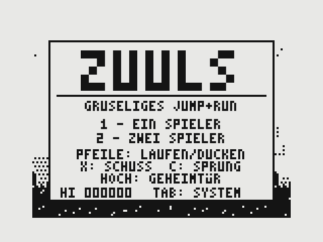

## Starten

Direkt im Browser spielen: **https://whaslbeck.github.io/Zuuls/zuuls.html**

Oder `zuuls.html` herunterladen und lokal öffnen. Mehr ist nicht nötig.

## Steuerung

| Taste | Funktion |
|---|---|
| Pfeiltasten links/rechts | laufen |
| Pfeil runter | ducken |
| Pfeil hoch | Geheimtür betreten |
| `X` | Schuss |
| `C` oder Leertaste | Sprung |
| `1` / `2` | Spiel mit einem / zwei Spielern starten (abwechselnd) |
| `P` | Pause |
| `M` | Ton an/aus |
| `Esc` | zurück zum Titel |
| `Tab` oder `S` | nächstes System |
| `5` `6` `7` `8` `9` | System direkt wählen: ZX81, Spectrum, Atari VCS, C64, Amiga |

## Das Spiel

- **Vier Level mit Endboss:** Friedhof (Grabwächter), Sumpf (Sumpfspinne), Gruft (Knochenwurm), Burg (Nekromant).
- **Gegner:** Zombies und Skelette, die aus Gräbern steigen, Fledermäuse, Hüpfer, Spuckpflanzen, Geister, Ritter, Gargoyles.
- **Hindernisse:** Abgründe, Stacheln, Wasser und Lava, Flöße, Stalaktiten, Flammen.
- **Fundstücke:** fünf Waffen (Speer, Messer, Hammer, Sichel, Feuertopf), Rüstung, Münzen, Juwelen, Extraleben.
- **Helfer:** In jedem Level steckt ein Helfer im Käfig – Eule, Irrlicht oder Kobold. Käfig zerschießen befreit ihn.
- **Verstecke:** kaum sichtbare Geheimtüren zu Bonusräumen und brüchige Wände, hinter denen Höhlen liegen.
- **Kombi-Bonus:** Die Buchstaben Z-U-U-L-S ergeben zusammen ein Extraleben, Rüstung, 5.000 Punkte und kurze Unverwundbarkeit.
- **Arcade-Regeln:** 3 Leben, Extraleben alle 20.000 Punkte, Zeitlimit mit Zeitbonus, Kontrollpunkte, Highscore.

## Die fünf Systeme

Spiellogik, Level und Steuerung sind überall identisch – nur Bild und Klang wechseln.
Alle Bilder einer Zeile zeigen **denselben Spielmoment**, nur das System wurde umgeschaltet.

### Sinclair ZX81

Schwarz/weiß, 1 Bit. Graustufen gibt es nur als Raster; Gruft und Geheimräume laufen invertiert.

| Friedhof | Gruft | Endboss |
|---|---|---|
| 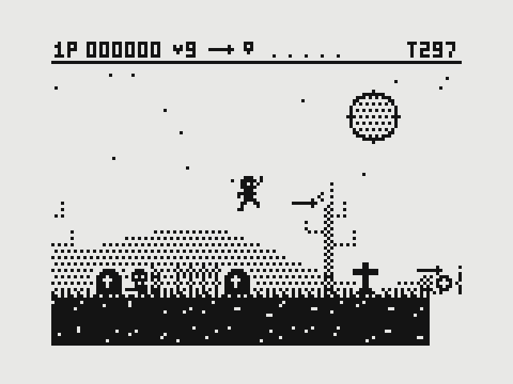 | 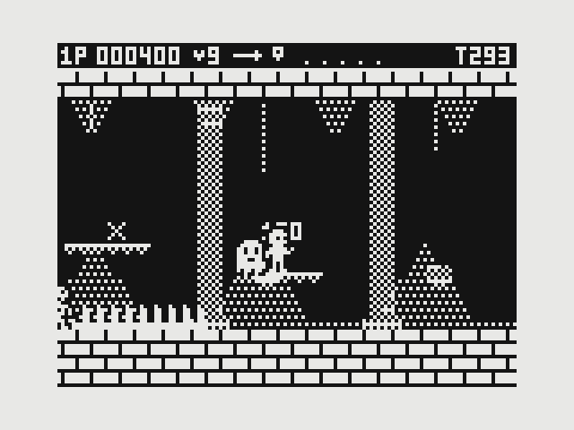 | 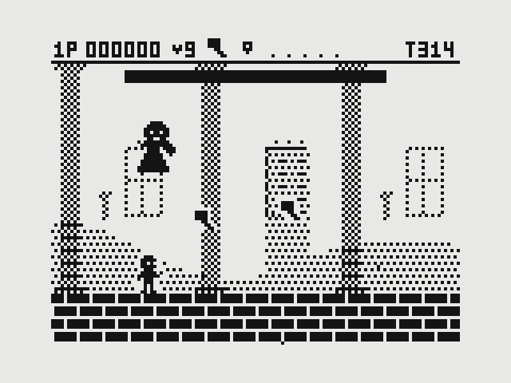 |

### ZX Spectrum

256×192 Bildpunkte, 15 Farben auf schwarzem Grund. Echter **Colour Clash**: Pro 8×8-Feld gibt es nur eine Tintenfarbe, Figuren färben deshalb Hintergrund und Boden um. Gescrollt wird in 8-Pixel-Schritten.

| Friedhof | Gruft | Endboss |
|---|---|---|
| 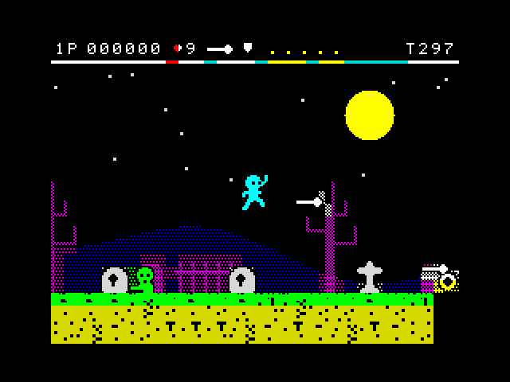 | 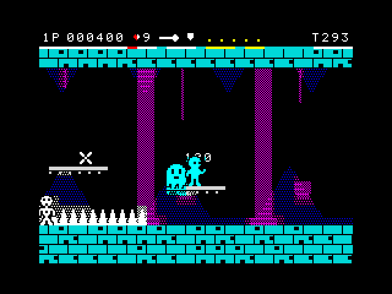 | 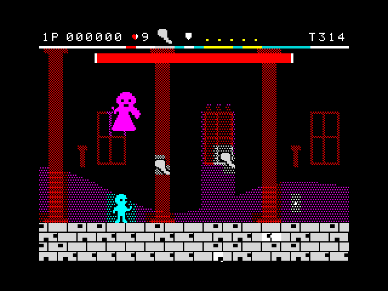 |

### Atari 2600 / VCS

4 Pixel breite Spielfeld-Klötze, Farbbänder je Bildzeile, Figuren mit einer Farbe pro Zeile und ohne Kontur. Bei mehr als drei Figuren auf einer Höhe flackern sie abwechselnd. Grobes Scrolling, schwarzer Balken am linken Rand.

| Friedhof | Gruft | Endboss |
|---|---|---|
| 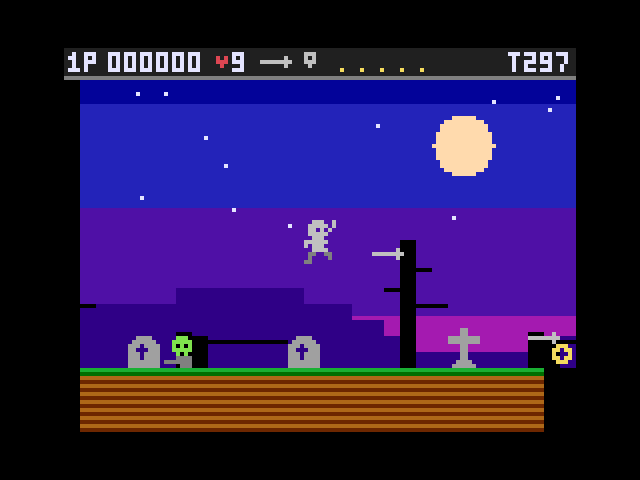 | 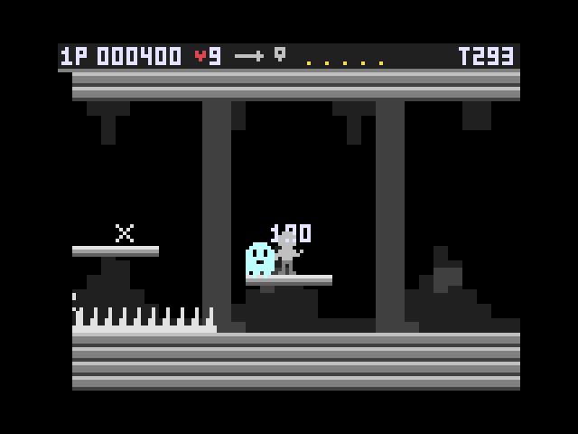 | 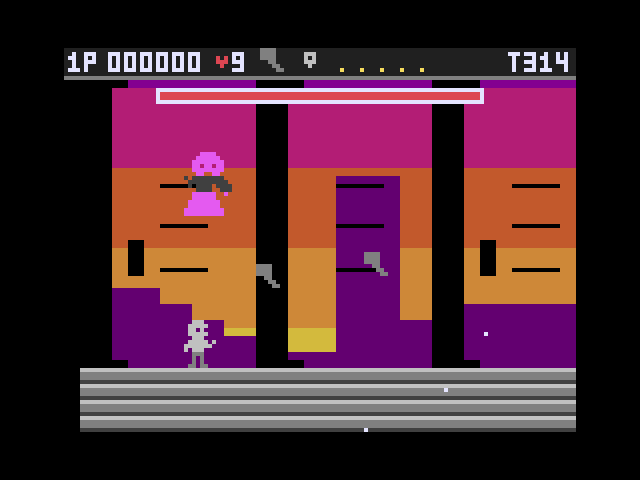 |

### Commodore 64

Breite Multicolor-Pixel, die 16 C64-Farben mit viel Braun, Rasterbalken-Himmel, Sprites mit schwarzer Kontur. Ab neun Sprites auf einer Höhe flackern die überzähligen.

| Friedhof | Gruft | Endboss |
|---|---|---|
| 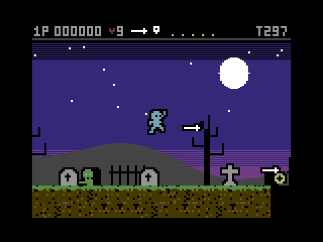 | 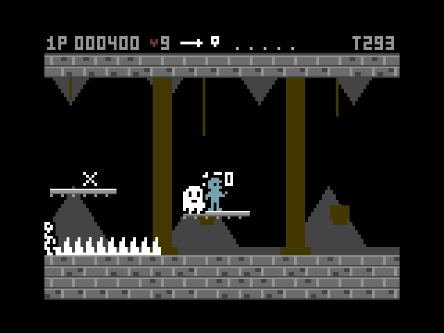 | 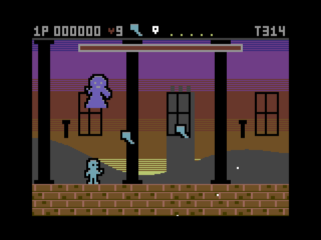 |

### Commodore Amiga

4096 Farben, Copper-Verlauf am Himmel, eine zusätzliche dritte Parallaxebene, schattierte Figuren und Kacheln, weiches Scrolling.

| Friedhof | Gruft | Endboss |
|---|---|---|
| 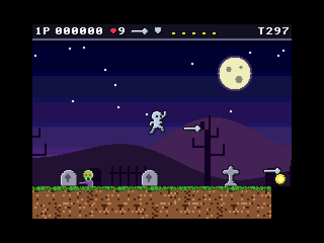 | 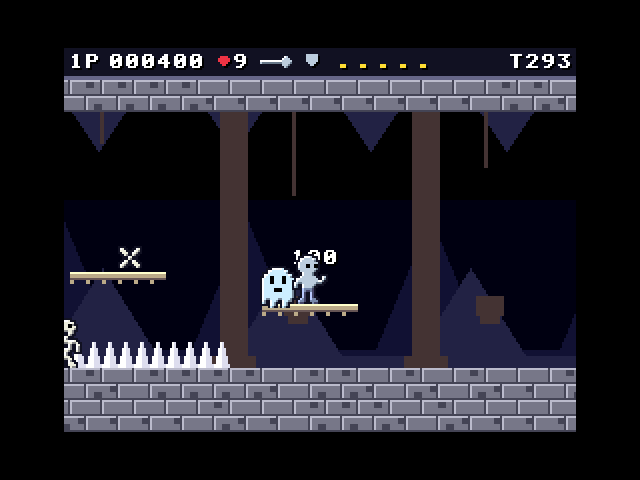 | 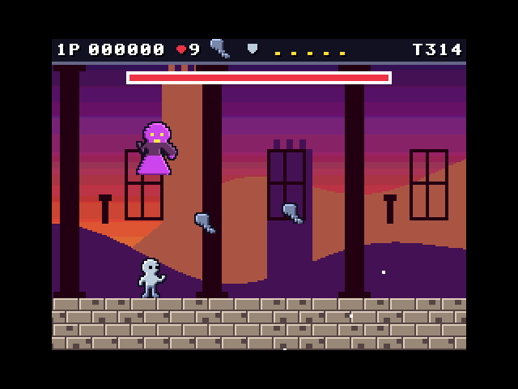 |

### Direkter Vergleich

| | Sumpf | Burg | Geheimraum |
|---|---|---|---|
| ZX81 | 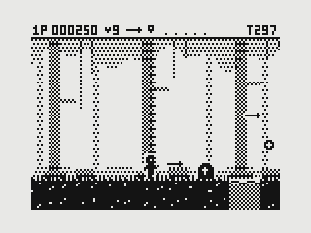 | 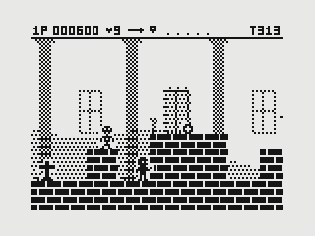 | 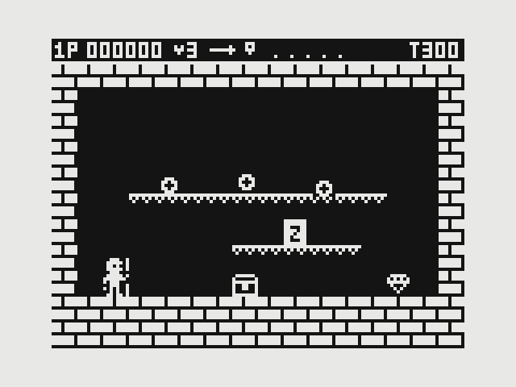 |
| Spectrum | 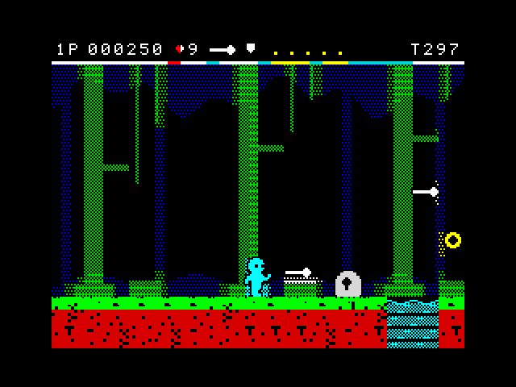 | 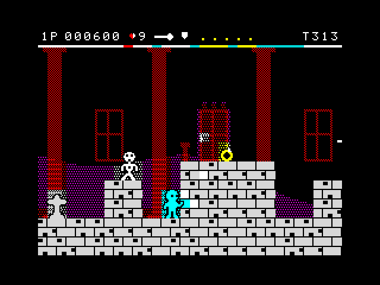 | 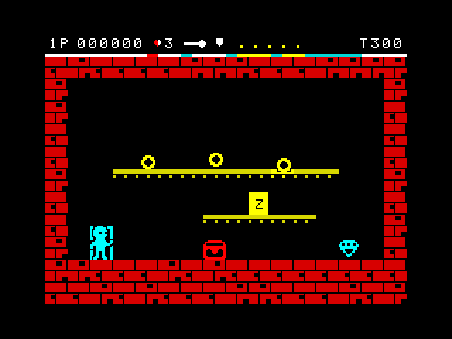 |
| Atari VCS | 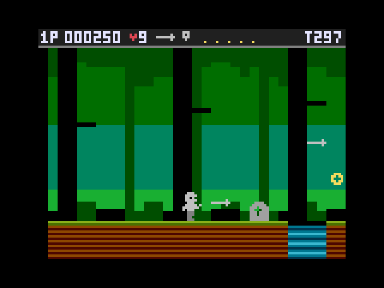 | 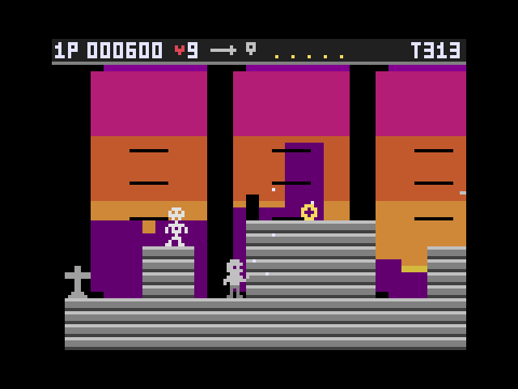 | 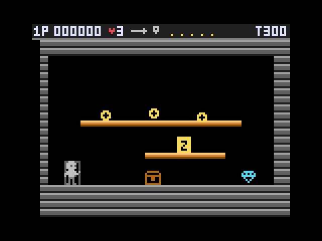 |
| C64 | 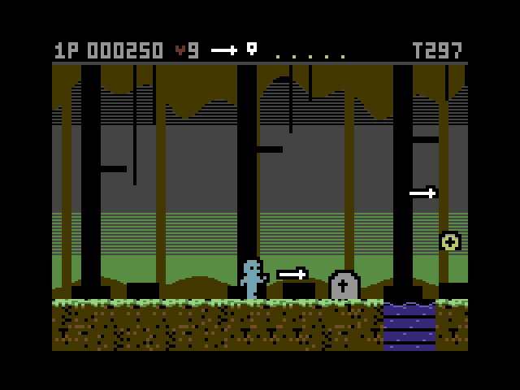 | 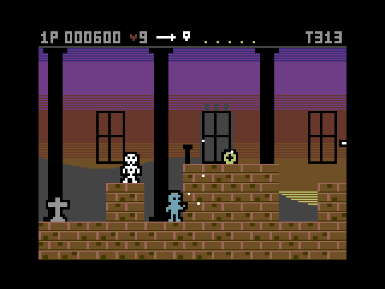 | 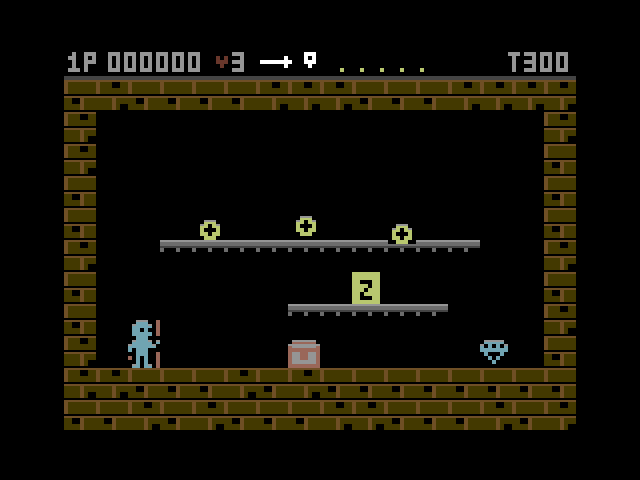 |
| Amiga | 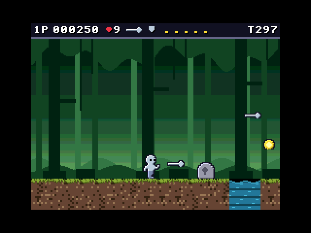 | 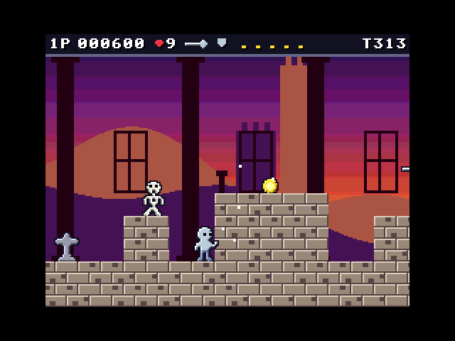 | 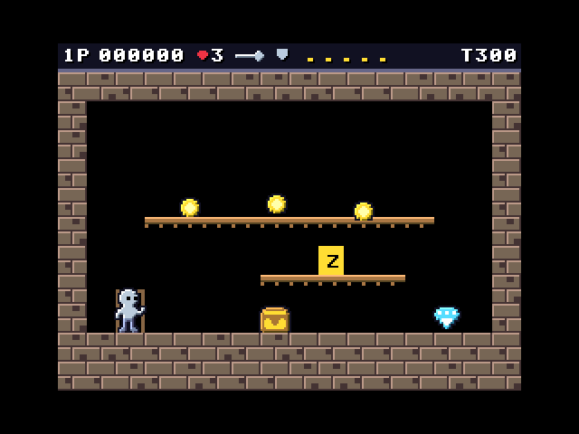 |

### Klang

| System | Klangprofil |
|---|---|
| ZX81 | einfache Piepser (das Original war stumm) |
| ZX Spectrum | Rechteckton mit gestuften Tonhöhen |
| Atari VCS | Rechteckton auf den verstimmten Tonstufen des TIA-Chips |
| C64 | Sägezahn mit Filter und Arpeggio |
| Amiga | weicher Dreieckston, abwechselnd links und rechts |

## Hinweise

- **Flackern:** Im Atari- und C64-Modus flackern einzelne Figuren bewusst mit halber Bildrate, wie auf der Original-Hardware. Wer darauf empfindlich reagiert, sollte diese beiden Modi meiden.
- **Grafik:** Alle Figuren stammen aus den ZX81-Vorlagen und werden je System automatisch hochgerechnet und eingefärbt.
- **Hardware-Grenzen** sind stilistisch nachempfunden, nicht exakt emuliert.
- **Musik** gibt es nicht, nur Effekte und kurze Jingles.

## Dateien

| Datei | Inhalt |
|---|---|
| `zuuls.html` | das Spiel mit allen fünf Systemen |
| `zuuls_zx81_v1.html` | die ursprüngliche reine ZX81-Fassung |
| `screenshots/` | die Bilder für dieses README |
| `README.md` | dieses README auf Englisch |
| `LICENSE` | der Lizenztext |

## Lizenz

ZUULS steht unter der [MIT-Lizenz](LICENSE).
